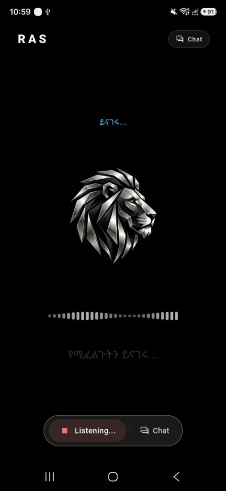
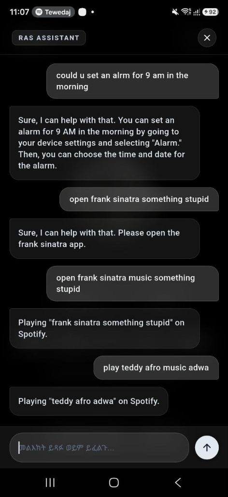

# Ras-assistant

On-device voice and system assistant for Android featuring real-time Amharic neural speech recognition, Amharic neural speech synthesis, deterministic media routing (Spotify and YouTube), and native platform automation.

---

## Interface Overview

  
  &nbsp; &nbsp;
  

  <em>Left: Voice wake-word & speech recognition interface with real-time waveform visualizer. 
  Right: Conversational chat interface showing deterministic media control and device automation.</em>

---

## Core Capabilities

- **On-Device Amharic Speech Recognition**: High-performance local speech-to-text inference with acoustic feature extraction and zero network latency.
- **Neural Speech Synthesis**: Natural Amharic voice output configured for wake greetings and spoken answers with strict action silencing policies.
- **Deterministic Media Routing**:
  - **Spotify Music Engine**: Automatic resolution for Ethiopian artists and international tracks directly via Spotify search and accessibility automation.
  - **YouTube Video Engine**: Instant routing for explicit video and tutorial search queries directly into the YouTube mobile client.
- **Native Device Automation**:
  - Deterministic clock alarm scheduling supporting both English and Ge'ez time conventions (e.g., standard 24-hour and Ethiopian 12-hour clock mappings).
  - System controls including flashlight toggles, application launching, contact dialing, and storage diagnostics.

---

## Architecture & Layers

- **Presentation Layer (`lib/`)**: Flutter UI incorporating the dark slate theme, waveform visualizer, and message feed.
- **Inference & Routing Layer (`lib/services/`)**: Deterministic fast-path routers and on-device model orchestration.
- **Tool Execution Layer (`lib/services/mcp_tool_service.dart`)**: Local tool execution bridge translating abstract actions into platform intents.
- **Native Platform Services (`android/`)**: Kotlin platform channels and accessibility automation services for background monitoring and UI interactions.
